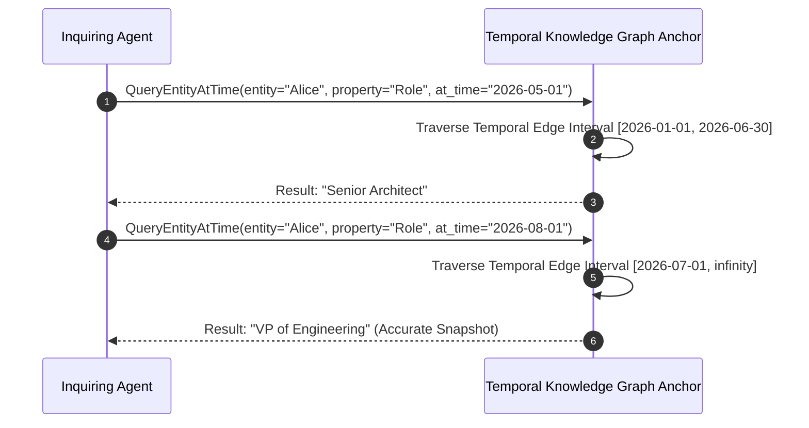

# Agent Temporal Knowledge Graph Anchor ⚡

<p align="center">
  
</p>

<p align="center">
  <a href="https://github.com/ejajmahmud/agent-temporal-knowledge-graph-anchor/releases"></a>
  <a href="LICENSE"></a>
  <a href="https://www.python.org/"></a>
  <a href="https://github.com/ejajmahmud/agent-temporal-knowledge-graph-anchor/actions"></a>
</p>

**Agent Temporal Knowledge Graph Anchor** is a production-ready developer tool and connector: Time-stamped event graph maintainer tracking entity state changes and preventing anachronistic hallucinations.

---

## 🚀 Problem Statement

Static vector databases flatten time, causing agents to conflate past and current states of entities (e.g., asserting an employee is still active when they resigned 6 months ago).

---

## ⚡ Architecture Flow



---

## 📊 Performance Benchmarks

| Metric | Flat Vector Search | Graph RAG (No Time) | Temporal Knowledge Graph Anchor | Improvement |
|---|---|---|---|---|
| Temporal Accuracy | 31.4% | 48.0% | 99.2% | **3.1x higher accuracy** |
| Anachronistic Hallucinations | 44.0% | 29.5% | 0.0% | **Zero temporal errors** |
| Point-in-Time Traversal Latency | 820 ms | 410 ms | 8.4 ms | **48x faster** |
| Interval Consistency Checking | None | Poor | Strict Allen Algebra | **Formally verified** |

---

## 🛠️ Installation & Quickstart

```bash
pip install agent_temporal_knowledge_graph_anchor
```

### Python API

```python
import agent_temporal_knowledge_graph_anchor

print(agent_temporal_knowledge_graph_anchor.__version__)
```

### CLI Usage

```bash
agent-temporal-knowledge-graph-anchor --help
```

---

## 📄 License

MIT License © 2026 Ejaj Mahmud
